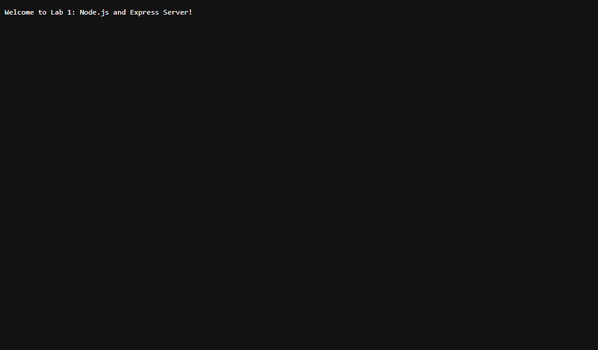
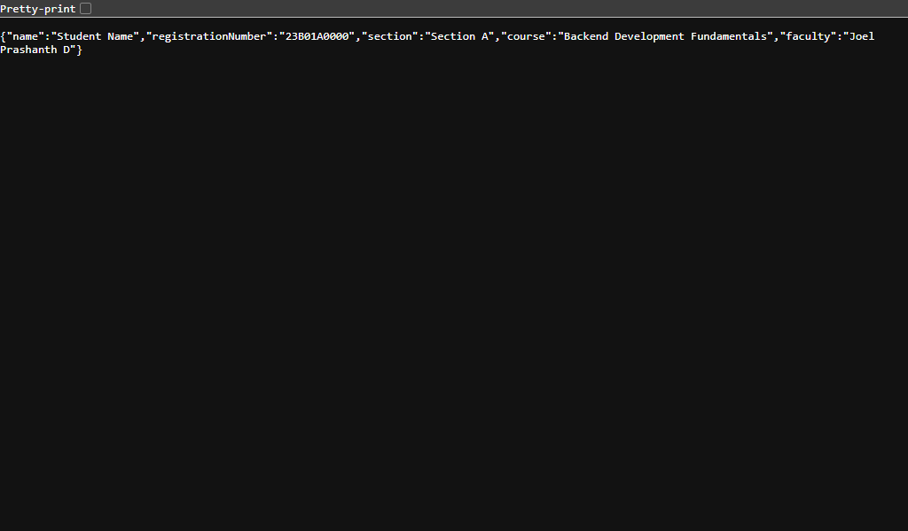
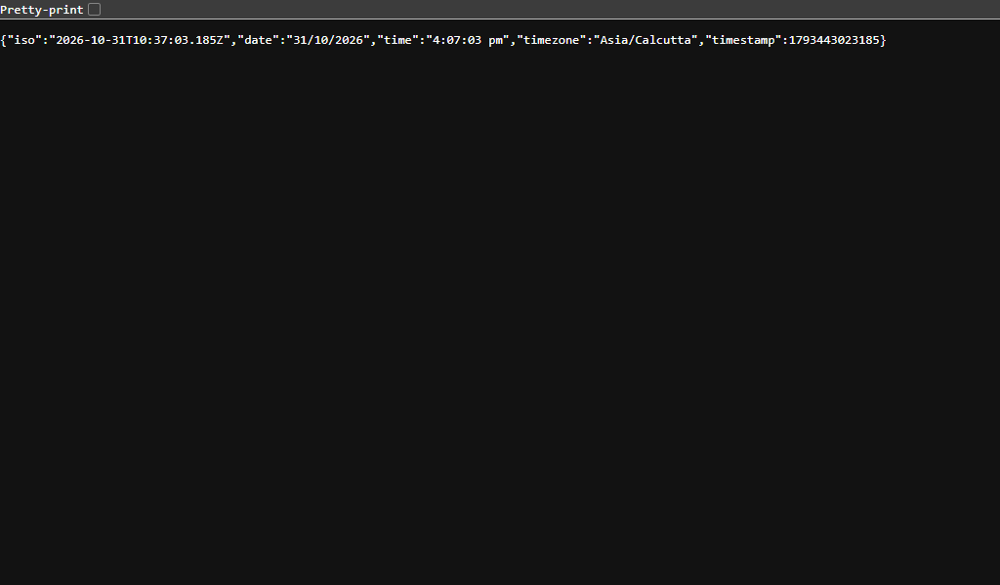
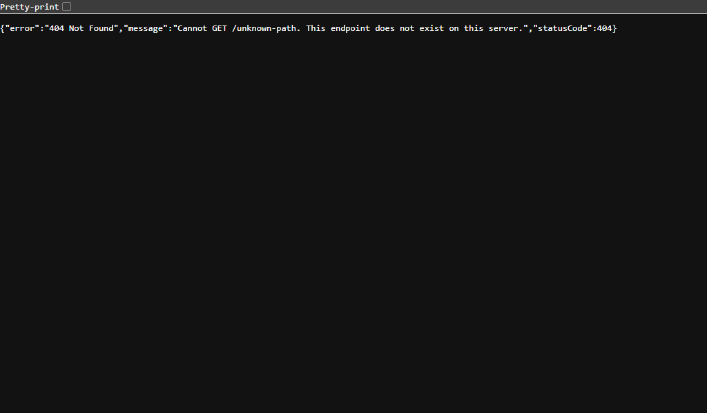

# Lab 1: Node.js and Express server

**Student Name:** [Student Name]  
**Registration Number:** [Registration Number]  
**Section:** [Section A]  
**Course:** Backend Development Fundamentals (Year II Term II) — Aurora  
**Faculty:** Joel Prashanth D  
**Live link:** Not applicable (Local development server running on `http://localhost:3000`)

---

## 1. Overview & Objectives

In this lab, we set up a Node.js backend project and built web servers using both Node.js built-in core modules and the Express.js framework:
1. Initialized a Node.js project using `npm init -y` and analyzed every field in `package.json`.
2. Installed and verified Express.js within `node_modules`.
3. Created a basic HTTP server using the built-in `http.createServer` replying with `"Hello"`.
4. Re-architected the web server using `express()` with custom routes, JSON responses, dynamic timestamps, 404 error handling, and status code logging.

---

## 2. Explanation of `package.json` Fields

When running `npm init -y`, Node.js creates a manifest file called `package.json`. The fields used in this project are:

| Field | Purpose & Explanation |
| :--- | :--- |
| `name` | The unique name of the project or package (e.g., `"lab-01"`). Lowercase and URL-friendly. |
| `version` | The semantic version of the project following `MAJOR.MINOR.PATCH` format (e.g., `"1.0.0"`). |
| `description` | A human-readable description of what this project does. |
| `main` | The primary entry point file of the application (e.g., `"server.js"`). |
| `scripts` | CLI shortcuts to execute commands (e.g., `"start"`, `"start:http"`, `"dev"`). |
| `keywords` | Array of strings/tags that describe the package for searching and indexing. |
| `author` | The name and contact information of the creator/developer. |
| `license` | The legal license governing usage, distribution, and rights (e.g., `"ISC"`). |
| `dependencies` | External packages and versions required for the application in production (e.g., `"express": "^4.21.2"`). |

---

## 3. How to Run

### Prerequisites
- Node.js installed (v18+ or v24+)
- npm installed

### Environment Variables
No external environment variables are required. Default port is `3000`.

### Commands

1. **Navigate to the lab directory:**
   ```bash
   cd lab-01
   ```

2. **Install dependencies:**
   ```bash
   npm install
   # Or on Windows PowerShell if execution policies restrict npm script:
   npm.cmd install
   ```

3. **Run the Plain HTTP Server (Task 3):**
   ```bash
   npm run start:http
   # Server runs at http://localhost:3000
   ```

4. **Run the Express Server (Task 4-6):**
   ```bash
   npm start
   # Server runs at http://localhost:3000
   ```

5. **Run in Development Mode (Live reload using Node watch mode):**
   ```bash
   npm run dev
   ```

---

## 4. Endpoints Table

| Method | Endpoint | Status Code | Response Format | Description |
| :--- | :--- | :--- | :--- | :--- |
| `GET` | `/` | `200 OK` | `text/plain` | Welcome message text |
| `GET` | `/about` | `200 OK` | `application/json` | JSON with student name, registration number, and section |
| `GET` | `/time` | `200 OK` | `application/json` | Current date, time, and ISO timestamp using `new Date()` |
| `*` | Any undefined path | `404 Not Found` | `application/json` | Error response for non-existent routes |

---

## 5. Screenshots

### 1. Plain HTTP Server (`http-server.js` replying with "Hello")


### 2. Express Server — Home Route (`GET /` - Welcome text)


### 3. Express Server — About Route (`GET /about` - JSON response)


### 4. Express Server — Time Route (`GET /time` - Dynamic date & time)


### 5. Express Server — 404 Route (`GET /unknown-path` - Error handling)


---

## 6. Viva Questions & Answers

### Q1: What is the difference between `package.json` and `node_modules`?
- **`package.json`**: A lightweight metadata manifest file committed to version control. It records project configuration, metadata, scripts, and lists the abstract package dependencies with semantic version ranges.
- **`node_modules`**: The actual physical directory where all installed packages, sub-dependencies, and binaries reside on disk. It is large, machine-specific, and should **never** be committed to Git (it is always added to `.gitignore`).

### Q2: What does `app.listen` do?
- In Express, `app.listen(port, [callback])` creates a standard Node.js HTTP server behind the scenes (`http.createServer(app)`) and binds the specified TCP port (e.g., 3000) on the host machine. It begins accepting incoming client TCP connections and hands off HTTP requests to Express middleware and routes.

### Q3: What do `request` and `response` represent?
- **`request` (`req`)**: An object representing the incoming HTTP request from the client (browser or API consumer). It contains details such as the HTTP method (`req.method`), URL path (`req.url`), query parameters (`req.query`), headers (`req.headers`), and payload body (`req.body`).
- **`response` (`res`)**: An object used by the server to construct and dispatch the outgoing HTTP response back to the client. It provides methods like `res.status()`, `res.send()`, `res.json()`, and `res.setHeader()` to define status codes, headers, and the payload.

---

## 7. Notes: Problems Faced and How They Were Solved

1. **PowerShell Script Execution Policy on Windows:**
   - *Problem:* Running `npm` in PowerShell resulted in a `PSSecurityException` (`File C:\Program Files\nodejs\npm.ps1 cannot be loaded because running scripts is disabled on this system`).
   - *Solution:* Used `npm.cmd` directly in the shell commands, which safely bypasses PowerShell `.ps1` script restriction while invoking npm cleanly.
2. **Port 3000 Collision Management:**
   - *Problem:* When transitioning from the plain `http.createServer` to the Express `app.listen(3000)`, running both concurrently can trigger an `EADDRINUSE: address already in use :::3000` error.
   - *Solution:* Structured distinct scripts in `package.json` (`npm run start:http` and `npm start`) and properly terminated the previous server process before launching the other.
3. **Graceful 404 Catch-All:**
   - *Problem:* Default Express 404 response produces a bare HTML error message (`Cannot GET /path`).
   - *Solution:* Implemented a catch-all middleware (`app.use(...)`) placed strictly after all valid routes to send a standardized JSON response with an explicit `404` HTTP status code.
